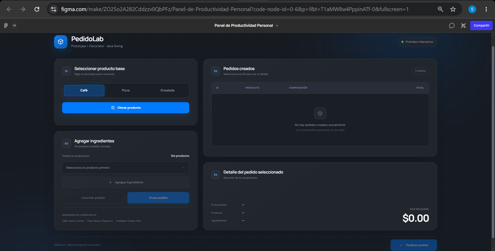

## Ejemplo de plantilla 



# PedidoLab, Prototype - Decorator

Aplicacion desarrollada en Java que implementa los patrones de diseno creacional Prototype y estructural Decorator para la personalizacion de pedidos en una cafeteria universitaria.

## Desiciones de diseño

- Uso de BigDecimal para el dinero: Se uso BigDecimal en lugar de numeros decimales normales para que las cuentas de los precios salgan exactas siempre y no fallen por errores de redondeo de la computadora.

- Juntar la logica en el servicio: Todo lo que es calcular precios y revisar si un ingrediente se puede usar o crear los IDs se puso en una sola clase de servicio para que la ventana solo sirva para mostrar los botones y la tabla sin enredarse.

## Diagrama de Relaciones

```text
[ RegistroPrototipos ] --------(administra y clona)--------> [ Prototipo<T> ]
                                                                     ^
                                                                     | (implementado por)
                                                             [ ProductoBase ]
                                                              /      |       \
                                                           Cafe   Ensalada  Pizza

[ Pedido ] <--- (implementado por) --- [ DecoradorIngrediente ] <--- (extendido por) --- [ Azucar, Crema, Tomate, Pollo, Queso, Pepperoni ]
    ^                                        |
    |---- (implementado por) ----------------+


