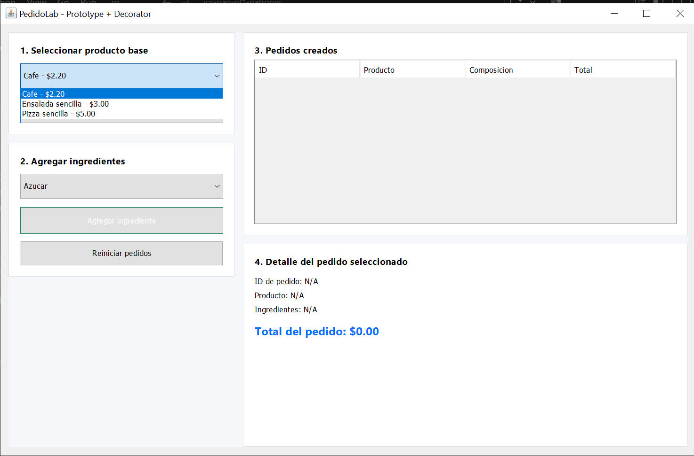
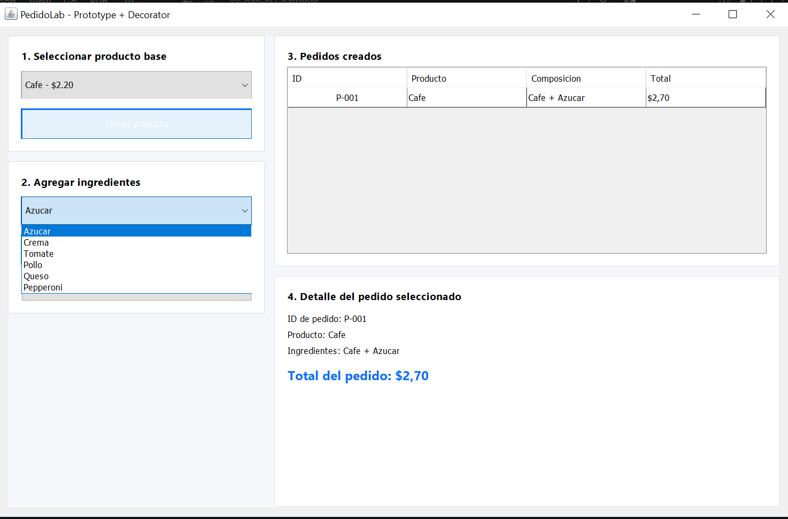

# PedidoLab

## Tabla de Casos de Aceptacion (CA01 - CA11)

| ID | Operacion / Entrada | Resultado Esperado | Resultado Real | Patron Validado | Estado |
|---|---|---|---|---|---|
| CA01 | Clonar Cafe dos veces | IDs diferentes; ambos empiezan en $2.20 | ID P-001 ($2.20) y P-002 ($2.20) | Prototype | Aprobado |
| CA02 | Comparar clon y objeto del registro | Referencias distintas; prototipo intacto | Referencias unicas independientes | Prototype | Aprobado |
| CA03 | Al primer Cafe agregar Azucar y Crema | Descripcion con ambos; total $3.90 | Cafe + Azucar + Crema; $3.90 | Integracion | Aprobado |
| CA04 | Consultar el segundo Cafe sin ingredientes | Mantiene $2.20, sin ingredientes adicionales | Cafe base puro a $2.20 | Prototype | Aprobado |
| CA05 | Clonar Ensalada y agregar Tomate y Pollo | Total $5.60 | Ensalada sencilla + Tomate + Pollo; $5.60 | Integracion | Aprobado |
| CA06 | Clonar Pizza y agregar Queso y Pepperoni | Total $7.10 | Pizza sencilla + Queso + Pepperoni; $7.10 | Integracion | Aprobado |
| CA07 | Intentar agregar Queso a Cafe | Operacion rechazada; sin cambios | Mensaje de rechazo por incompatibilidad | Validacion | Aprobado |
| CA08 | Agregar ingrediente sin pedido seleccionado | Mensaje claro y ningun cambio de estado | Advertencia mostrada correctamente | Validacion | Aprobado |
| CA09 | Solicitar clon de clave inexistente | Fallo controlado; no se crea pedido | Excepcion capturada sin crear registros | Prototype | Aprobado |
| CA10 | Agregar dos veces Azucar a un Cafe | Total $3.20 y dos aplicaciones | Cafe + Azucar + Azucar; $3.20 | Decorator | Aprobado |
| CA11 | Reiniciar y volver a clonar Cafe | Nuevos pedidos parten de $2.20 | Lista limpia y contador de ID reiniciado | Prototype | Aprobado |

## Explicacion de donde se implementa cada patron

- Patron Prototype: Se encuentra implementado en la interfaz que es Prototipo<T>, tambien la clase abstracta ProductoBase y sus subclases concretas como Cafe, Ensalada, Pizza. La clase RegistroPrototipos almacena estas instancias base y realizam el metodo clonar el cual llama al metodo copiar de cada producto para generar copias independientes en memoria.

- Patron Decorator: Se implementa como interfaz en Pedido, tambien en la clase abstracta DecoradorIngrediente que esta se almacena en pedido envuelto, y los decoradores concretos Azucar, Crema, Tomate, Pollo, Queso, Pepperoni. Esto permite adjuntar para poder sumar costos y agregar descripciones sin variar las clases originale.

## Capturas de salida 

# PLANTILLA EVIDENCIAS

### Asignatura: Programacion Aplicada
### Carrera: Computacion
### Estudiante: Sebastian Andres Arenillas Ponce
### Fecha de Entrega: 09/11/2026

## Resumen de ejecucion
- Casos Ejecutados: 11 / 11
- Casos Aprobados: 11
- Casos Fallidos: 0

## Observaciones del equipo
- La utilizacion de BigDecimal aseguro la precision en los calculos monetarios sin errores de redondeo.
- La separacion entre la capa de servicio y la capa de vista nos permitio validar el comportamiento de los patrones separados antes de llegar a la interfaz grafica.

## Conclusiones
- La creacion de objetos mediante el patron Prototype evita juntar el codigo cliente a construcciones un poco mas complejas lo que nos permite clonar configuraciones base de forma limpia y rapida.

- El patron Decorator resuelve el problema de combinacion de las subclases lo que nos permite agregar ingredientes de manera libre en tiempo de ejecucion en lugar de crear mas clases.

- Una limitacion de esta solucion basada en decoradores anidados es que consultar o filtrar ingredientes especificos dentro de la cadena requiere recorrer recursivamente los objetos envuelto.